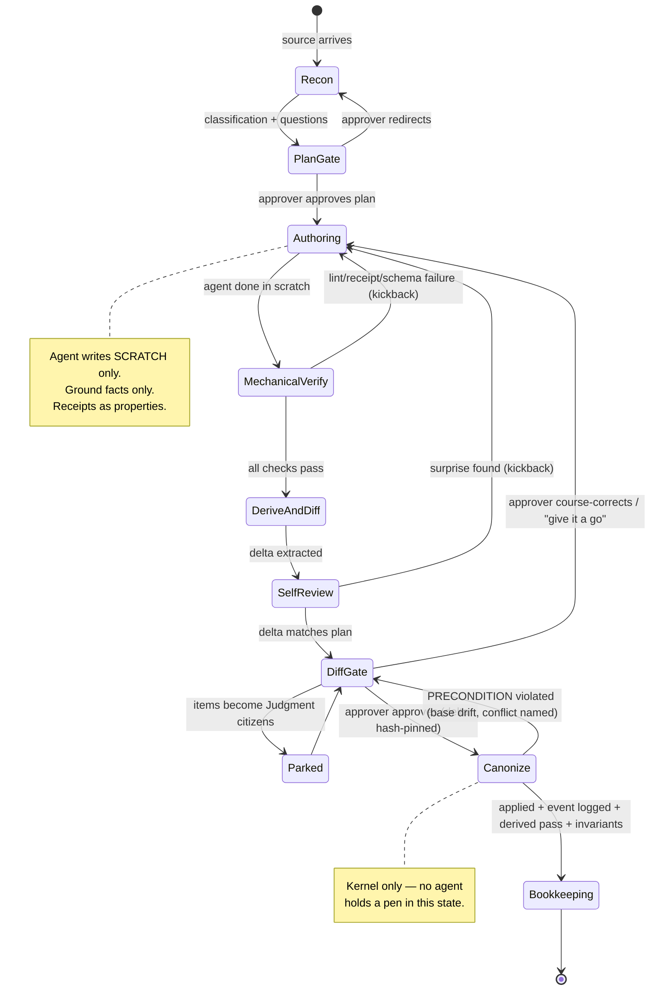
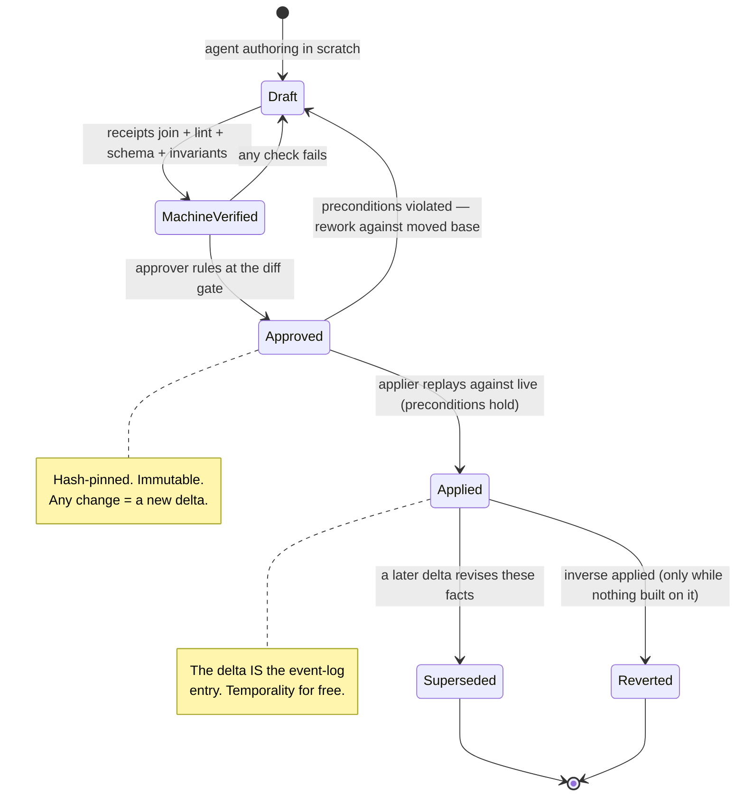

# Agentic ETL — the Persistent-Graph Era

*** DESIGN DOCUMENT — REQUIRES DESIGNER REVIEW ***

The successor architecture to the derived-graph ETL. One paragraph: **the
proposal is a graph, review is a graph walk, verification is a query, and
the only code is a fixed micro-kernel that never grows.** Agents author
ground facts directly in a scratch graph — *scratch for now*: whether
isolation in the end means a branch of the live graph, a lock,
or a temporal mechanism is the open decision below, and everything else
in this design survives any of those answers. The reviewable artifact is
the **delta**; canonization is deterministic replay of an approved delta;
the delta is the event-log entry; derived layers are never authored by
anyone. No code is ever generated.

This document is the review surface: a twin-track narrative (what the
submitter experiences / what happens under the hood), the process state
machine, the delta lifecycle, and the open isolation decision.

## The words this document uses

Plain-language definitions up front, so the narrative reads without
insider knowledge:

- **Ground fact** — something the source material directly asserts ("the
  Cinder Fox guards the Hollow Gem"). Contrast **derived fact** —
  something the machine can compute from ground facts (classification
  towers, "which procedures read a Beast's Grade"). People and agents
  write ground facts; machines recompute derived facts from scratch every
  time, so nobody's hand-written copy can silently rot.
- **Scratch graph** — a private working copy of the database. Nothing
  done there touches the real one.
- **The reading room (comprehension graph)** — where the machine's
  understanding of a dumped artifact lives: its fingerprint identity and
  its section tree (bodies, order, nesting, embedded-table refs). Canon
  is the knowledge; the artifact's insides are comprehension material (see
  "The reading room" below).
- **Delta** — the complete, itemized list of proposed changes (see
  "Anatomy of a delta"). It is the thing you review, the thing you
  approve, and the permanent record of what changed.
- **Receipt** — a verbatim quote from the source attached to a proposed
  fact, so every claim can be checked against evidence.
- **Stub** — a concept the graph knows *exists* but hasn't modeled yet;
  the running to-do list of ideas awaiting real treatment.
- **Judgment citizens** — open questions, decisions, and to-dos stored in
  the graph itself, with history, instead of in loose notes.
- **The two gates** — the two moments that require you: approving the
  *plan* (before any work) and approving the *diff* (before anything
  becomes real).

---

## The narrative: you hand the agent a doc with a table

Running example: `sources/03-the-hollow-wood.md` arrives, containing a
Beasts table. "Let's intake this."

### Phase 1 — Recon

**What you experience:** nothing yet. The agent reads quietly for a minute.

**Under the hood:** the agent reads the doc cold and identifies, by
**semantic comprehension**, every entity, relationship, and rule the
content asserts — regardless of casing or formatting discipline (not
everyone capitalizes their terms; identification is reasoning about
meaning, never a word search). Pronouns and other indirect references get
special attention — "they pass it to their thing" requires resolving who
*they* is and what *it* refers to — so recon may take **multiple
disambiguation passes**, and a reference that stays genuinely ambiguous
is escalated to the owner as a question rather than guessed at. Each
candidate the agent identifies is then
**resolved deterministically** through the term index (resolves / stub
exists / unknown — that half stays exact), and read-only Cypher explores
the neighborhood: existing citizens the table touches, the stub worklist
("Beast" may already be a stub from a prior round), prior Judgment rows.
The mechanical capitalized-run sweep still runs, demoted to a **backstop
tripwire** — it catches candidates comprehension missed, never defines
the candidate set. Output: a classification with confidence buckets —
*relates-to*, *introduces*, *uncertain* — and a routing call (which graph
this belongs to). The live graph is touched only by reads.

### Phase 2 — The plan gate (yours)

**What you experience:** the what's-this-about proposal — what the table
is, what it maps onto, what's new — and it leads with an **implications
preview** in plain terms: what you GET ("the Beasts become queryable — a
reader can ask 'which Beast guards the Hollow Gem?'"), what you LOSE or
change ("the Chapter's prose meaning narrows to the Beasts on this
list"), and what it AFFORDS later ("the Beast-lineage rules get their
anchor concepts"), each with a real example pulled from the corpus. Then
the questions only you can answer: what things should be called ("Beast
or Creature?"), how they relate to what exists, and how they behave ("do
Beast Grades form a ranked ladder?"). You rule, redirect, or park
items. This is today's intake interview, unchanged — with the
implications stated before the questions, so you rule in context.

**Under the hood:** nothing has written anywhere. The proposal's claims
were pre-checked against the graph's vocabulary during recon, so the
questions that reach you are the handful that genuinely need a human —
the mechanical majority never surfaces.

### Phase 3 — Authoring in the scratch graph

**What you experience:** "Working — I'll come back with a diff."

**Under the hood:** the kernel **copies base → scratch** (the one
concession to infrastructure; see Isolation below). Whole-graph copies
are fine while the graph is small; the scale path is a **relevant-subset
scratch** — recon's neighborhood defines the working set, the kernel
copies that plus its boundary, and anything the subset turns out to need
is fetched from base on demand. What the subset couldn't see is exactly
what the apply-time preconditions re-check against full live, so a
too-small working set degrades to a kickback, never to a wrong apply. The agent — holding
write credentials *for scratch only* — creates nodes and edges directly:
`MERGE (:Beast {name: 'Cinder Fox', ...})`, ground relationships to
existing citizens, each assertion carrying its **receipt as a property**
(`from_text`, source pointer, authority grade "agent-proposed"). If the
table is quirky, the agent also writes a normalized canonical
intermediate, hash-pinned to the source. It works the way agents
naturally work: create, query its own work, fix, iterate.

To be precise about what "ground facts only" bans — because it is NOT
"no edges": the agent freely creates nodes *and* edges that the source
asserts (a Beast, its GUARDS relationship to a Gem). What it may
never write are the **derived** kinds — classification edges
(INSTANCE_OF), signature projections (READS/MUTATES/CALLS), term-index
entries — because those are *computed from* the ground facts by the
kernel, and the whole point is that a computed layer cannot drift: if an
agent hand-wrote them, its copy would be wrong the moment the ground
facts changed, and nobody would notice. (This lesson was paid for twice
in the derived era.) The machine recomputes; nobody transcribes.

### Phase 4 — Mechanical verification

**What you experience:** still nothing. Failures never reach you.

**Under the hood:** the kernel runs queries against scratch: the
**receipts join** (every `from_text` verbatim in its source node's body —
the source doc was ingested as a Provenance citizen in this same delta),
term-index resolution (every referenced citizen exists or is new in this
delta), the **ground-facts-only lint** (any derived edge type = reject),
schema conformance against the embedded ontology, key/idempotency
checks. Violations kick straight back to Phase 3.

### Phase 5 — Derive + diff

**Under the hood:** the kernel runs the **derived post-pass** over scratch
(metamodel tower, projections, term index, ladders — today's machinery,
re-rooted) and the **invariant suite** (`.cypher` checks: placeholder
census, bijections, tower completeness). Then **extract-delta**: scratch
minus base = the changeset, including which *derived* edges appeared as
consequences of the ground facts.

### Phase 6 — Self-review

**Under the hood:** the agent reads the delta against its own plan.
Surprises — an unexpected projection, an invariant complaint, a
high-confidence item the machine bounced — are fixed (back to Phase 3) or
demoted to the uncertain bucket. Render-back fidelity diffs run where the
content is procedure-shaped.

### Phase 7 — The diff gate (yours)

**What you experience:** the delta, four ways — led, whenever the delta
touches the ontology or metaontology layers, by the **schema-changes
section with its blast radius**, before anything row-level —
1. the **implications narrative**: plain prose on what this change means,
   with concrete examples drawn from the existing corpus;
2. a statement-level table with **claim beside evidence** (each assertion
   next to its receipt);
3. the derived-consequences summary ("these 12 projection edges will
   appear");
4. a walkable view: open Bloom on scratch and *explore the proposal as a
   graph* — and because every delta member is tagged with the delta id,
   you can filter to **just the new and changed things**, or see them
   highlighted in context against unchanged canon.

Uncertain items are presented for ruling: resolve, "give it a go" (loop
to Phase 3), or park as Judgment citizens. Your approval pins the delta
by hash.

**Under the hood:** the approved artifact is now immutable. Any further
change is a new delta.

### Phase 8 — Canonization

**What you experience:** "Landed. Batch #N in the log."

**Under the hood:** the kernel's **applier** — no agent anywhere in this
phase — replays the approved delta against live, after checking
**preconditions**: every citizen the delta references still exists and
still matches the base snapshot's expectations. A violated precondition
(live moved since the scratch was cut) kicks back to Phase 7 with the
conflict named — detection, never cleverness. On success: the delta is
appended to the **event log** (it *is* the event; back-out = replaying
its recorded inverses, with the doctrine-consistent caveat that once
later deltas build on it, back-out becomes supersession). Derived
post-pass and invariants re-run on live — **including the delta's own
generated tests, which join the permanent suite from this moment**: the
next proposal is checked against this one's regressions forever.
Provenance stamped (batch id, approval, `approved_in`). The delta
artifact archives in git.

### Phase 9 — Bookkeeping

**Under the hood:** worklist maintenance (stubs graduated, pending
instances realized), Judgment rows for parked items, glossary/skill
updates — all themselves delta content through the same pipeline, smaller
stakes. The backstop sweep should show fewer unknowns than before the
round: the worklist shrinks forever.

---

## The reading room (comprehension graph)

*Designer ruling (recorded as the canon-is-the-knowledge Decision row).*

**Canon is the knowledge.** The canonical graph holds Concepts and
Judgments, plus thin provenance anchors. A dumped artifact's *insides* —
its section tree, bodies, order, heading hierarchy, embedded-table
references — are the machine's understanding of the artifact, and they
live in the **comprehension graph**: a separate workspace the pipeline
builds per intake round (`python -m graph comprehend <artifact>`).

The lifecycle is **build → archive → dispose**:

- **Build** — one well-known workspace database (`comprehension`), wiped
  per round like scratch. Never a standing database per asset.
- **Archive** — at round close the room serializes to small flat files
  under `graph/comprehension/<name>-<fingerprint12>/` (git-tracked, like
  `graph/export/`). Any set of archives batch-imports back into the room
  (`--recall`) for browsing; rounds coexist because every citizen
  carries its artifact's fingerprint.
- **Dispose** — the live room is wiped (`--dispose`); the archives are
  the record.

**Canon's side of the line** (the thinning): canon keeps one thin
anchor per artifact — the citizen, carrying a content-hash
`fingerprint` — and citations are **artifact + span**: a procedure's
`specified_in` names `{artifact, section, approved_hash}` and is
verified against the file's bytes directly; the SPECIFIED_IN edge lands
on the Artifact with the section as edge detail. No section citizens,
no mentions index on canon (the room's assertions layer is the
successor; until it lands, "which sections discuss X" is answered by
text search).

This thinning is the rule for a canon that is ABOUT a domain — where
a dropped artifact is *evidence for* the knowledge, not the knowledge
itself. A corpus whose prose IS the knowledge — its records carried as
citizens, sections with verbatim bodies on the graph — inverts the
rule by design: there the sections are canon, and once the prose lives
on the graph there is no separate source left to anchor to
([engine-as-corpus.md](engine-as-corpus.md)).

**Identity rules.** An artifact's identity is the sha256 of its bytes —
one collaborator's `Downloads` copy and another's `Temp` copy are the
same artifact; paths and titles are display metadata. Sections carry
machine-internal ids derived from fingerprint + structural position
("3f2a9c1d4e5b:2.0.1") — deterministic, so a deleted archive's structure
recomputes bit-identical from the immutable bytes. Quirks inside a
dumped artifact (duplicate headings, skipped levels) are the pipeline's
job to absorb silently — never a submitter-facing warning. Canon-side
references (procedure citations, receipts) use fingerprint + span, never
comprehension ids, so canon integrity survives total archive loss.

**Content classes.** Every span of every section is classified so
the round-trip harness can dispatch it to the right renderer and judging
bar: `table` ({{csv:}} embeds), `procedure` (sections cited by a
procedure's specified_in), `rule-prose` (the default — the machine never
guesses flavor), and `verbatim-carried` (flavor text, approver-assigned
at the plan gate, never deduced). The **carried fraction** — how much
prose is carried verbatim — is the honesty valve's metric, reported per
artifact so "just store it verbatim" cannot silently become the whole
round-trip proof; the ceiling is approver-set and enforced by the
harness.

**The parity harness** consumes the classes: `python -m graph
roundtrip --scope <artifact> --draft <regeneration>` judges a draft at
the functional-parity bar — chapter scope, never section-by-section
(structure is free): tables at cell-level content equivalence with row
integrity, procedures against the approved programs' atoms (answer keys
add behavior teeth), prose through the claim-diff judge,
approved flavor byte-intact, inventions checked once against the
combined original corpus. One scorecard, every red named, exit nonzero —
no human in the comparison step. The cold draft itself is produced by
the fenced regeneration loop; the harness only judges.

The plan gate reads its structure view from the room; the assertions and
canon-impact layers of comprehension join with the first intake round
that runs through it.

## The process state machine

## Anatomy of a delta

A delta is **comprehensive** — the complete, itemized mutation set, every
class enumerated so full roll-back is always possible:

1. Nodes to create
2. Existing nodes to edit (per-property before → after)
3. Existing nodes to delete
4. Edges to create
5. Existing edges to edit (per-property before → after)
6. Existing edges to delete
7. Any other mutation class the schema grows (the list is closed per
   delta, never implicit)

**Derived edges are shadows, not itemized removals.** A machine-computed
edge (an INSTANCE_OF, a signature projection) never enters the list as a
bare deletion — it is a shadow of the ground-fact change that re-derives
it, so deleting a node is never blocked by the computed edges hanging off
it (re-derivation owns them at apply). Authored derived-edge *additions*
and paired modifications still itemize, so the lint can refuse them and
the diff-gate reader sees every consequence.

Every entry records its **inverse** (the before-image), which is what
makes the event log reversible. Every entry carries its receipt, source
pointer, and authority grade. Every member is **tagged with the delta's
id** — this is what lets exploration tools isolate "just the proposal."

One mutation class is **distinguished above all others**: changes to the
graph's own schema layers — the embedded ontology and metaontology
citizens. These have the biggest echoes: a project-schema edit can
re-derive edges across the whole graph, and a kernel (metaontology) edit
is ceremony by doctrine. The delta therefore classifies schema-layer
mutations into their own section, presented FIRST at the diff gate, with
a blast-radius summary ("this schema change re-derives 214 edges across 6
labels") — you should never discover a schema edit by stumbling over it
among row-level facts.

Two more things ride inside the delta document itself:

- **The implications narrative** — a prose explanation of what the change
  *means*, in crisp human-comprehensible statements with concrete
  examples pulled from the corpus wherever possible ("The Cinder Fox now
  guards the Hollow Gem: a reader asking what the Fox protects gets the
  Gem…"). Written for a person, not a parser; reviewed at the diff gate
  alongside the itemized list.
- **The delta's tests** — generated regression checks that ride with the
  change (new `.cypher` invariants, answer-key assertions where a fact
  table overlaps). They run at verification, run again at apply, and then
  join the permanent suite — the persistent-era form of "tests ride with
  the feature." Tests are data, not code; the kernel's check-runner never
  grows.

The delta is **live through the gates**: every human-in-the-loop
course-correction at the plan or diff gate updates it in place — what you
approve is always the current delta, and approval is what freezes it
(hash-pinned; any change after that is a new delta).

## The delta lifecycle (the artifact's own states)

**Implemented.** The states above are machinery now: cutting
scratch pins the base's content identity (`graph/proposals/current/
base.json`, working state, gitignored); `delta` writes the canonical
proposal document whose sha256 IS the proposal's id; `approve` records
{delta_hash, base_hash, by} — run by the submitter or an agent on their
behalf, the record naming the human (escalation routing for protected
change classes is an open Question); and `canonize --apply` refuses
without an approval, refuses if the base moved (warn at draft, refuse
at apply — re-cut and re-review), and refuses if scratch drifted from
the approved changeset, naming the divergence item by item. On success
the round's artifacts archive to `graph/proposals/<id12>/` —
git-tracked, the durable audit trail.

**Visibility and pocket readability** are designed at
[lenses.md](lenses.md): scratch rounds are the branch pattern
(branch = pinned base + delta is the contract; the clone is a cache),
permissions own only branch readability, and everything about what is
visible WITHIN a graph belongs to the lens layer, enforced on the
in-memory graph value — never to Neo4j privileges.

**Same-round endpoints — the stitch.** A round that births a
citizen in its schema edit cannot author ground edges pointing at it in
scratch (scratch is cut pre-schema, so the endpoint does not exist to
point at). Those edges ride the round's stitch file
(`graph/proposals/current/stitch.json`); the proposal document embeds
them, so the approval hash covers them and one diff gate rules the
whole round. `delta` lints the stitch narrowly (ground facts only; an
edge both of whose ends already exist belongs in scratch) and previews
its landing against the graph the round will actually produce; at
apply the stitch lands in memory after re-derivation births the
endpoints and before anything is written — the same
verify-all-before-apply-any window as every other precondition. The
inverse removes stitched edges like any other addition.

**Branches — independent lines of truth within a KB.** The default line
is live canon (the unnamed line every command works on absent a branch),
with `scratch` as its authoring copy. A *branch* is a second line WITHIN
the same knowledge base: `restore --branch <name> --base schema-only`
projects canon's schema stratum alone (`schema_only` — the complement of
`strip_derived`: the Archetype citizens and their DECLARED_IN / SUBTYPE_OF
/ Archetype-level ladder edges, no ground, no machine layers) into the
branch's own database and writes the branch's first backup, pinning the
round against that content identity — "the whole chapter, from nothing."
Each branch owns a home — `graph/branches/<name>/{export,proposals,
applied.log}` — with its own backup, chained event log, and authoring copy
(`<name>-scratch`), and `delta` / `approve` / `canonize --apply` each learn
`--branch <name>`: the full verify-all-before-apply-any round, targeting the
branch's own database and re-exporting the branch's backup and log. The
hard guard: a branch-scoped apply can never touch the live canon database —
the applier refuses by name (before any read or write) if the resolved
target is the KB's canon. The schema freeze still applies inside branches
(the lint is shared). One check relaxes by design: the **procedure
roster census** (every registered program file has its citizen) is a
completeness property of a *finished* line, and a branch mid-rebuild is
incomplete on purpose — so branch-scoped rounds carry roster findings as
advisories (in the delta report and at apply) instead of refusals, while
the default line keeps them as hard errors. The check returns to full
strength when a branch stands for succession: a branch must be
roster-clean to be adopted. Succession — a branch *becoming* canon — is
the owner's ceremony, never a flag. A branch is one line within one KB, the
atom; a *world* (a KB that mounts other KBs) and a *Pocket Universe* (a
correlation of branches across KBs at one collated gate) are the future
composition layer above it, not a branch.

**Succession — the ceremony itself.** `succession --branch <name>` is
the one sanctioned crossing of the branch/canon boundary. The dry run
walks every verify gate and writes nothing; the apply run walks the
same gates, then adopts. The verify phase collates, verify-all-before-apply-any: live
canon must still byte-match its own committed backup (nothing moved
outside the delta path), the branch database must byte-match the
branch's backup, both chained event logs must verify unbroken, the
branch must re-derive clean with the roster census at full strength
(the advisory era ends at this gate), the ground-facts lint must be
clean over the branch's whole line (its ground diffed from its own
schema stratum, so the round lint judges the entire line at once), and
the version anchor must ride the branch. On any failure the refusals
collate and nothing is written. Adoption proceeds capture-first: the
outgoing canon is archived as a branch (`--archive-as`, default
`superseded-<sequence>` — export, event log, and archived rounds copied
into a new branch home) BEFORE anything is overwritten; the branch's
graph is stamped with canon's next event-log sequence, so the version a
fresh connection reads keeps climbing through the ceremony; the live
canon database is rebuilt from it and the backup re-exported FROM the
database; and canon's chained log gains ONE adoption entry whose
payload slot carries the adoption record's content hash. The record —
archived with canon's rounds and doubled as the `adopted.json` marker
in the branch home — names who ruled, when, the adopted branch, its
chain tip and export identity, the canon identities before and after,
and the archive branch. Canon's chain therefore continues unbroken
across the ceremony while the branch's own fine-grained log survives in
its archived home: lineage is cryptographic, not conventional (owner
rulings, 2026-08-20). An adopted branch is provenance, not a working
line — further rounds on it refuse by name. Walk-back is a second
ceremony: rehydrate the archive branch's database (`restore --from
graph/branches/<archived>/export --database <archived>`), then run
succession on it.

**Findings are rows**: the parity harness files every judged
difference as a structured row — archived as `findings.jsonl` beside
the artifact's reading, and landed in the workspace room as
`(:Finding)-[:JUDGED_FROM]->(:Section)` with a status lifecycle (open →
escalated → ruled). Identity is content-derived, so a re-judge MERGEs
onto the same rows: worked statuses survive re-runs, findings that no
longer red are swept. The prose scorecard is a rendering of the rows.

**Verdicts are records** (the delta gate's half of the same doctrine):
every lint refusal, ceremony item, and advisory is born as a typed
record — a stable code, the subject citizen or connection as a
`{label, name}` ref, the human sentence, the standalone remedy, and the
structured particulars — and the report surfaces are renderers over the
model (`graph/report.py`). The markdown the approver reads and
`graph/reports/delta-report.json` are the SAME facts rendered twice, so
a downstream voice can re-say a verdict from its code, subject, and
remedy without parsing prose. The JSON report is a rendering, not a
frozen artifact: verdicts derive deterministically from the pinned
changeset and base, which is where tamper-evidence already lives. The
string surfaces (`lint`, `ceremony_classify`, `render_report`) remain
as renderings of the records, byte-for-byte what they always said —
golden parity tests hold them to it.

**The event log is real.** Every applied round now writes: its
**inverse** (computed mechanically from the before-images — the undo
record made executable), a **chained entry** in
`graph/proposals/applied.log` (each line naming its predecessor's hash;
rewriting any entry breaks every later link), and passes a **replay
check** at apply time — the logged delta applied to the pinned base
must reproduce the ground truth the file edits produced, every time.
File-era honesty: removals are manual approver acts canonize never
executes, so the log marks them pending; the replay compares the
executed subset. The walk-back (apply, then apply the inverse, return
byte-identical to base) is a standing test — "event log with
inverses and a demonstrated walk-back", delivered. Post-flip
the graph-native applier (the same pure applier, spoken in Cypher)
executes everything and becomes primary.

---

## The isolation decision

**RULED for the buildout:** the scratch-copy column
carries the agentic era's first implementation — in the derived era,
"copy base to scratch" is `python -m graph load --database scratch`
(rebuild from sources), agent writes land on top through the scoped
`neo4j-scratch` connection, and canonization applies the approved delta
graph-natively to canon (THE FLIP, below), editing no source files.
**The pocket-universe question is deferred, not
settled** — owner ruling: iron out ETL first, then solve pocket
universes. The table below stays as the briefing for that future ruling.

Where does the scratch live? Three candidate mechanics, no decision baked
in. The owner's standing observation frames the stakes: **cracking
pocket-universe-on-live makes the temporality problem largely disappear**
— work never touches canon until approved, so back-out is mostly about
*unapplied* work, which is free.

| | Overlay-on-live | Scratch copy | Lock the graph |
|---|---|---|---|
| Mechanics | draft assertions live in the same store, tagged (grade/named-graph-style); queries resolve overlay-first, fall back to canon | clone the DB (or rebuild base into a second database); work there | single writer; agent works directly on live behind a lock; approval = unlock, rejection = rollback |
| Isolation | weak-by-default — every canonical query must scope correctly, forever | strong — leakage impossible | none during work; the lock *is* the boundary |
| Cross-references to canon | trivial (same store) | need the copy to be complete | trivial |
| Diff ergonomics | the overlay IS the diff | external comparison (kernel's extract-delta does the work) | transaction log is the diff |
| Cost | query-scoping machinery + tombstones ("canon has X; pocket removes X") | copy time/space per proposal | forecloses concurrent sessions and long-running review; a week-long open proposal blocks everything |
| Prior art | RDF named graphs; Datomic speculative `with`; assertion grades (the source-authority ladder as the pocket boundary — "querying at a trust threshold") | CAD workspaces; today's branch-and-rebuild | classic single-writer DB |
| Temporality bonus | subsumes it (the owner's observation): tentative work is *visible but graded*, never canon until promoted | subsumes it: tentative work is elsewhere entirely | does NOT subsume it — mutations hit live during work; needs the event log to be trustworthy from day one |

Note the grade-based overlay quietly unifies three prior designs: the
confidence buckets from the ingest workflow, the source-authority ladder
(deferred Question), and Judgment-style supersession. "Pocket" stops
being a place and becomes an epistemic status.

---

## The micro-kernel: five organs, fixed forever

| Organ | Exists today? |
|---|---|
| copy-base-to-scratch | exists — `restore --database scratch` cuts the round from canon's committed backup (post-flip). Scale path: relevant-subset copies (recon's neighborhood + boundary, fetch-on-demand), guarded by apply-time preconditions against full live |
| extract-delta | new (the committed export snapshot diff is its rebuild-era ancestor) |
| apply-delta (+ precondition checks) | **new — the genuinely novel organ**, together with the event log |
| derived post-pass | exists (metamodel, projections, term index) — needs re-rooting from "empty base" to "any base" |
| check-runner over `.cypher` invariants | exists (`make check`) — suite needs persistent-era additions |

Plus one lint: **ground-facts-only** on deltas (trivial). Nothing else.
Every future capability lands as *data* — schema, glossary, recipes,
checks, proposals — never as kernel growth.

**THE FLIP IS DECLARED** (owner ruling): the graph
is primary. The export is the backup (restore drilled), the event log
is the version control of record. **The freeze is lifted**:
canonize --apply is graph-native — pinned changeset onto the ground
layer, machine layers re-derived (one derivation codepath with the
bootstrap extractor, proven byte-identical), canon loaded, backup
re-exported from the database, event log chained. Data-plane intake is
open. **The schema inverted**: the schema stratum is ground on
the graph — Archetype citizens and their edges are authored truth,
preserved by the strip and never rebuilt by derivation; post-bootstrap
commands read the schema from the graph (`ontology_from_graph`), the
anchor's version auto-stamps from the event-log sequence, and
ontology.yaml is bootstrap provenance for the from-sources path only.
Schema changes ride the SCHEMA CEREMONY: an ordinary owner-gated round may add a new declared concept, birth a new label (a spec-carrying row with nothing yet underneath it), edit a schema row's doc text, add an alias to a label's spec (a new surface spelling reading as an existing citizen — additions only), or remove an unreferenced schema row — itemized under the delta report's marked ceremony section, whose approval IS the ceremony ruling. Changes to an existing label or spec move data underneath them and stay refused: they ride the migration charter.

## Invariants (the non-negotiables)

1. **The structural write boundary.** The agent's write credentials exist
   only for scratch. The live connection is physically query-only —
   separate database, separate auth, not a settings-file politeness. The
   agent holding a pen near canon is the one failure mode with no machine
   net under it. *Real: the live connection rides a query-only reader
   user (read-only on canon, scratch not even visible); a write attempt
   dies at the database with Forbidden. The settings-file deny remains as
   the second belt.*
2. **Derived layers are never authored** — by agent, human, or tool.
   Ground facts in, derivations recomputed. An agent-emitted INSTANCE_OF
   is asserted-signature drift at graph scale (the lesson the engine paid
   for in the derived era, generalized).
3. **Only approved artifacts touch canon**, and approval pins by hash.
   The applier replays exactly what was approved or nothing.
4. **Preconditions at apply, detection over cleverness.** Base drift
   kicks back with the conflict named; the applier never merges
   creatively.
5. **Receipts are properties, verification is a join.** Every non-obvious
   ground fact carries `from_text`; source docs are Provenance citizens;
   the receipts check is a graph query, not a file grep.
6. **Two human gates for a mutating intake**: plan (before authoring),
   diff (before canonization). These two gates ARE the agentic approach's
   two engagement signals instantiated ([agentic-approach.md](agentic-approach.md)):
   the plan gate is the collated-ambiguity interview, the diff gate is the
   mutation consent. An intake trips both signals every time — it always
   disambiguates and always mutates — so it always has both gates; a
   read-only query trips neither and has none. Everything between the two
   gates is agent + kernel loops that never need you.
