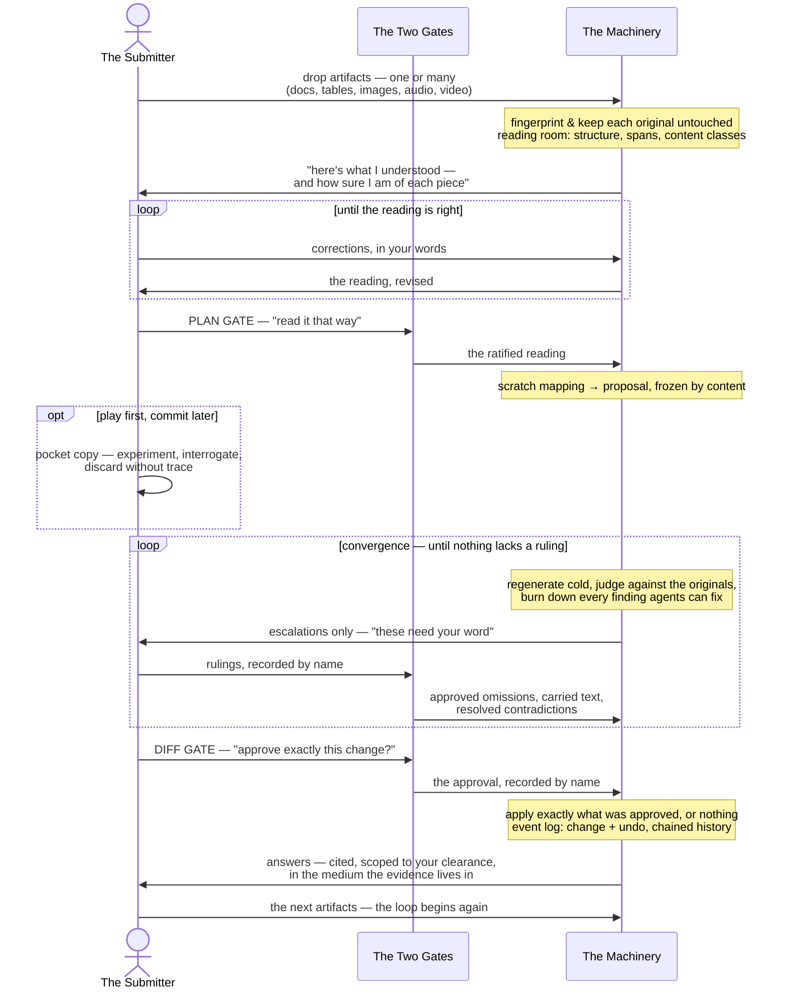

# The north-star workflow — two lanes, two touches

*One diagram: the submitter's lane on top, the machinery's lane beneath.
The north star's whole argument is that the two lanes exchange material
at the ends — the artifact flows in at the drop, answers flow back out at
the close — but exchange *decisions* at exactly two conversations: the
plan gate and the diff gate. Everything else the machinery does happens
without the submitter needing to know it exists. That both gates are
always present here is the mutating-job case of the agentic approach's
engagement signals — an ingest always disambiguates and always mutates;
the reconciliation is recorded once in [agentic-etl.md](agentic-etl.md)
(Invariant 6).*

## Glossary, for the lay reader

- **Artifact** — anything a person hands the system: a document, a
  table, an image, an audio or video file.
- **Canon** — the single shared world of agreed-true facts that
  everyone's work builds on.
- **Reading room** — the machinery's temporary workspace for
  understanding what was dropped; all artifacts in a submission are
  read into the same room, side by side. Disposable, never part of
  canon.
- **Pocket** — a private playground that behaves like your own copy
  of the world: a branch — canon plus your changes, physically its
  own database, readable only by you until you invite someone
  (permissions gate who may *see* the pocket; the isolation itself
  is the branch). Canon cannot be touched from inside it; exit and
  your view returns to canon, discard and nothing happened.
- **Proposal** — a bundled set of changes to canon, frozen so that what
  gets approved is exactly what gets applied.
- **Plan gate** — the first conversation: "here's how I read your
  artifact — did I read it right?"
- **Diff gate** — the second conversation: "here's exactly what would
  change in the world — approve it?"
- **Convergence loop** — the machinery re-checking and re-writing its
  own work until only questions needing human judgment remain.
- **Event log** — the permanent history of every applied change, each
  one undoable.
- **Serve** — answering questions from canon with citations, in the
  medium the evidence lives in, never inventing.

## Glossary, the working vocabulary

*The hardcore definitions — the lay glossary above stays the
gentle entry point. A knowledge base's own domain terms are
not here: they live on the graph itself
(`python -m graph terms`; every citizen carries its own doc)
and in the consuming project's own glossary.*

### The one people ask about first

**Floor** — a promise already made. Two braided uses. The **honest
floor** is the named list of everything still imperfect when work is
presented: remaining defects are classified and shown *with* the work,
never hidden under it — "an honest red beats a faked green." A
**corpus floor** is one owner-approved expectation made durable: the
check that guards it, the expectation in plain words, and the blessing
that made it a floor (a PR, a ruling), re-checked by `python -m graph
corpus` before any "done." Work may build *above* a floor; it may
never sink below one, and a floor whose guard vanishes is a loud red,
never a silence.

### Canon and the graph

**Canon** — the Neo4j canon database: the single source of truth
for everything the knowledge base asserts. Files are inputs and backups;
the graph is primary.

**Citizen** — any node that lives in canon. Facts, rulings, procedures,
quotes — if it matters, it's a citizen, queryable and owned.

**Backup / export** — `graph/export/*.jsonl`, written FROM canon,
committed to git. `restore` rebuilds the database from it alone.

**The drill** — restore from backup, then prove the database
re-serializes byte-identical. Run constantly; "DRILL PASSED" is canon's
heartbeat.

**Ground vs. machine layer** — ground facts are authored (by people or
gated rounds); the machine layer (Archetype nodes, derived edges like
INSTANCE_OF) is *computed* from ground + schema at every apply. Nobody
authors the machine layer; re-derivation owns it.

**Receipts** — review-evidence properties on authored citizens
(`from_text`, `source`, `grade`): the verbatim quote and provenance
that let a claim be checked. Never rendered into outputs.

### The two schema layers

**Metaontology (the kernel)** — the engine's own vocabulary
(`graph/metaontology.yaml`): the four roots (Concept, Facet,
Provenance, Judgment), Procedure, the Judgment family, the visibility
vocabulary. Project-agnostic — the membership test is "would a kid's
storybook project need it?" Semver'd; changes are **ceremonies**.

**Project ontology** — everything THIS knowledge base derived
(`graph/ontology.yaml`): its labels, catalogs, relationships.
Owner-governed, versioned as a plain revision number.

**Ceremony** — the deliberate act of changing the kernel: explicit
owner ruling, a Decision row naming it, the version bump and ledger
line in the same change set. Never casual, never a side effect.

### Rounds — how canon changes

**Round** — the unit of canon change: cut scratch → author → delta →
gates → apply. Nothing reaches canon any other way.

**Scratch** — a working database cloned from canon where agents author
freely. Wiped and re-cut per round; mistakes here cost nothing.

**Base pin** — cutting scratch records canon's content identity. If
canon moves mid-round, the apply refuses by name — no round lands on a
world that shifted under it.

**Pocket universe** — an isolated branch of the world: canon plus a
delta, physically its own database, readable only by its creator until
shared. Exit and your view returns to canon; abandon and nothing
happened. Branch = pinned base + delta is the contract; the clone is
an implementation detail.

**Delta / proposal** — the itemized changeset: scratch minus base,
linted (machine layers refuse authorship), rendered as a report. Its
content hash IS the proposal's identity.

**Plan gate / diff gate** — the two owner gates: the plan gate rules
on intent before authoring; the diff gate rules on the itemized delta
before anything lands. Consent binds to mutation.

**Approve → canonize --apply** — the approval freezes the proposal by
hash; the apply replays exactly that changeset: verify everything
before writing anything, re-derive the machine layer, re-export the
backup, chain the event log.

**Event log & inverse** — one chained, tamper-evident line per applied
round, with the delta's executable inverse recorded — every round can
be walked back.

**Stitch** — the same-round-endpoints mechanism: ground edges whose
target is born by this round's own schema edit ride a declared stitch
file, covered by the same approval, landing after re-derivation births
their endpoints.

**Rederive** — schema-bootstrap maintenance: recompute the machine
layer against the current schema, refusing if ground would change.

**Sitting** — an owner session that rules on a collated sheet of
questions in one pass, rule-by-exception welcome.

**Opening move** — every round's first duty: pay the previous round's
debts (stamp its PR onto its Judgment rows, land its deferred edges).

### The Judgment stratum

**Question / Decision / Answer / Opinion / Requirement / TODO** — the
kernel's ruling vocabulary, all citizens: something open; a ruling made
(by whom, when — supersession expected); a clarification; an agent's
judgment with confidence (junior until ratified); a binding constraint;
work pending. **Approved Omission / Approved Difference** — editorial
rulings the parity judge consults: this absence (or this changed
rendering) is blessed and passes forever. **Verbatim** — a passage
pinned to carry word-for-word; the stored bytes are the truth, the
normalized form is only a matching key.

### Quality machinery

**Parity** — the regeneration bar, owner-ruled: nothing lost, nothing
invented, nothing distorted; presentation free. The **judge** compares
claims mechanically and returns verdicts (matched, omitted, invented,
distorted); reds name themselves.

**Attribution** — the other half of the triangle: every claim in a
draft must find its home in canon. **Parity proves draft ≡ original;
attribution proves draft ⊆ canon** — and a claim that passes parity
but has no home is a hole in *canon*, found automatically.

**The ladder (rungs)** — how strong a claim's home is: **first-class**
(a citizen's structured properties, edges, or Step lifts carry the
fact), **receipt** (found in a citizen's carried sentence quotes),
**soup / prose-only** (found only inside long prose — an honest home
AND a named debt). The rung rides the verdict as its confidence.

**Census** — decomposing an artifact into claims and attributing every
one. **Fact grain** — the ruled claim size: one atomic assertion
("Mary gave Arthur an apple" is three claims).

**Soup map** — the census's output read as a debt map: which sections'
facts are structured citizens and which still live as prose blobs.
The prioritized worklist for ingestion.

**Gap vs. invention** — a homeless claim splits on parity: the
original says it → canon gap (a debt; shipping never stops); parity
called it invented → a named red, presented with the artifact, never
hidden. **Phantom gap** — a "gap" the matcher couldn't see was already
home; **laundering** is removing phantoms from the worklist by reading
structure, not just text.

**Corpus** — the ledger of floors (`graph/corpus/floors.jsonl`) plus
the command that re-checks them all; a deleted guard reds as "the
guard is gone," naming the blessing it orphaned.

**Tripwire** — a test that exists to refuse a specific forgetting: the
schema-version ledger, the roster check, the vocabulary leak. When a
tripwire reds, it worked.

### Runs and margins

**Run / trace** — one casting of agents against a brief, its record
kept as a run-scoped judgment graph: who was cast, what they were
told, what they consulted, what they judged. Claims about runs cite
traces; recollection is not a source.

**Margin** — the system's own annotations on an artifact, span-anchored
(the quote re-locates if the text moves): low-confidence calls,
uncertainties, questions. The owner replies in the same margin; the
reply threads to the Opinion it answers.

**Earned citation** — strong-form attribution: a citation counts when
the cited citizen appears in the drafter's trace. Right-answer-wrong-
path re-derives invisibly.

**Park, never die** — a blocked or interrupted run keeps its state and
resumes; the owner never has to say "try again."

### Lenses — who sees what

**Visibility Class** — a named set of graph elements; the only unit
permissions speak about. Kind **knowledge** (assume-deny: hidden
unless granted) or **masking** (assume-allow: removed only when a mask
names it).

**Visibility Group** — a subject of sight; individuals are size-1
groups; groups nest. (Named "Visibility Group" because a knowledge
base may need the plain word "Group" for its own domain.)

**Verdict** — an authored ALLOWED or DENIED between a group and a
class; denies target flat classes only.

**Fold / lens** — the fold is a subject's transitive group set; the
lens is that fold compiled into what they may see, enforced on the
in-memory graph itself so edges never dangle and derived layers
recompute under it. **Activation** — wearing a subset of your groups
this session; exiting a pocket is a lens subtraction, not a
membership edit.

**Super admin** — no lens applied. Not a subject with every grant — the
absence of filtering.

**Redacted refusal** — the subject-facing answer for anything hidden:
one uniform "Nothing by that name that you can see." Candid
explanations are a curator privilege.

**Sealed reading** — intake's first phase: comprehend the artifact on
its own terms (kernel allowed, project canon forbidden) before any
mapping, so canon can't bias the reading. **Mapping phase** — then
each artifact-local claim is judged against canon: same-as / extends /
new / contradicts, every mapping a recorded Opinion.

### Campaign terms

**Re-ingest** — the declared milestone: rebuild canon clean from the
published knowledge base, rulings carried, the census as the ruler.

**Succession** — the original remains the parity reference until
the owner *explicitly* declares otherwise. No milestone implies it.

**Wave** — one gated slice of a campaign, sized by the worklist,
closed at a diff gate.

## The diagram

## Reading the diagram

- **Three lifelines, read top to bottom.** What passes directly
  between submitter and machinery is material and notice — artifacts
  in, the reading shown back, escalations surfacing, answers out. Every
  *decision* crosses through the middle column, the gates — that is
  the point.
- **The plan gate** ratifies *the reading*: how the artifact was
  understood — its structure, what each span is (table, procedure,
  rule-prose, carried flavor), and any concepts the mapping wants to
  create. Nothing about the reading is fait accompli; the machine's
  understanding is reviewable before it becomes work.
- **The diff gate** ratifies *the change*: every fact, beside the
  sentence it came from, with the blast radius named (whose work it
  touches, who gets notified). The convergence loop delivers to this
  gate only what agents could not resolve themselves — the submitter
  never sees finding 3 of 64; they see "these need your word."
- **The machinery's stations, in a phrase each**: *fingerprint & keep*
  — recognize the artifact forever and preserve the original untouched;
  *reading room* — understand its structure and what each piece claims;
  *scratch mapping* — translate the reading into the world's own
  vocabulary (the judgment step); *proposal* — bundle the changes,
  frozen by content; *convergence loop* — regenerate cold, judge
  against the original, burn down every finding agents can fix;
  *approval freeze* — record the ruling, by name, against exactly what
  was reviewed; *apply* — replay exactly what was approved or nothing;
  *event log* — archive the change and its undo, chained so history
  cannot be quietly rewritten; *serve* — answer from canon, cited,
  scoped to the asker.
- **The pocket** (upper lane) is deliberately gateless: anyone can make
  a copy, experiment, interrogate, and discard. Canon is untouchable
  from inside a pocket; a proposal carries only what the submitter chose
  to keep.
- **After canon** (Serve → Live with the world), the relationship
  inverts: the submitter asks and the machinery answers — scoped to
  their clearance, cited to its sources, in the medium the evidence
  lives in (images shown, audio played, video cued to the moment). A
  new question that canon cannot answer often becomes the next
  artifact — the loop's re-entry.

## What each lane never sees

The submitter never sees: fingerprints, content hashes, deltas,
inverses, chain verification, content classes, scratch databases. Those
words appear in the lower lane only.

The machinery never decides: what counts as flavor, whether an omission
is acceptable, how a contradiction resolves, when an experiment becomes
a proposal, what a Theme means. Those are ruling verbs, and every one
is recorded with the ruler's name.
